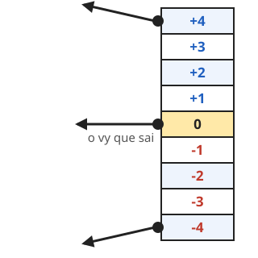

# Desafios da Aula 5 ⭐

**Terminou tudo? Escolha um desafio!** Quando conseguir, marque ☐ e mostre para o professor.
&nbsp; ⭐ fácil · ⭐⭐ médio · ⭐⭐⭐ difícil

<div class="cols cards" markdown="1">

<div class="box" markdown="1">
### ⭐ Vence quem fizer 3

Na **Bola** há **dois** testes do 7: um para cada jogador. Troque o **7** por **3** nos **dois**:

```blocks
se <(gols_1) = (3)> então
  fim_jogo (1)
end
```

E o outro com `gols_2` e `fim_jogo (2)`. Trocar em um só faz a partida acabar em 3 de um lado e em 7 do outro!

☐ Consegui!
</div>

<div class="box" markdown="1">
### ⭐ Som de vitória

Na **Bola**, dentro do bloco **fim_jogo**, **antes** do `diga`:

```blocks
toque o som (Clang v)
```

A Bola já tem três sons: **Pop**, **Oops** e **Clang**.

☐ Consegui!
</div>

<div class="box" markdown="1">
### ⭐ Paredes que fazem barulho

Na **Bola**, dentro dos `se` da parede de **cima** (posição y > 174) e da de **baixo** (posição y < -174):

```blocks
toque o som (Clang v)
```

Agora cada quique na parede faz barulho!

☐ Consegui!
</div>

<div class="box" markdown="1">
### ⭐⭐ Limite de velocidade

Nos **dois** `se` das raquetes, depois do `adicione`:

```blocks
se <(vx) > (15)> então
  mude [vx v] para (15)
end
se <(vx) < (-15)> então
  mude [vx v] para (-15)
end
```

**Por quê?** A partir de **24**, o passo da bola fica maior que a beirada da raquete e ela **atravessa**. Com o limite em 15, isso nunca acontece.

☐ Consegui!
</div>

</div>

## Mais desafios: ⭐⭐ e ⭐⭐⭐ {style="break-before: page"}

<div class="cols cards" markdown="1">
<div markdown="1">

<div class="box" markdown="1">
### ⭐⭐ Saque para quem levou o gol

No `se <(posição x) < (-234)>` (quando o **Jogador 1** levou o gol), **depois** do `bola_centro`:

```blocks
mude [vx v] para (-5)
```

A bola sai **para o lado de quem levou o gol**; o outro lado já sai com o 5 do `bola_centro`.

☐ Consegui!
</div>

<div class="box" markdown="1">
### ⭐⭐ Raquete com segmentos, como o Pong de 1972

Em 1972, cada pedaço da raquete devolvia a bola num **ângulo diferente**. Na **Bola**, dentro do `se` da **Raquete1**, depois do `mude [vx v]`:

```blocks
mude [vy v] para (arredondamento de (((posição y) - ([posição y v] de (Raquete1 v))) / (9)))
```

No `se` da **Raquete2**, faça o mesmo com **Raquete2** no lugar. O `posição y` da esquerda é o da **Bola**; o `de` pega o da raquete.

{style="max-width: 52mm; display: block; margin: 2mm auto"}

O **meio** devolve **reto**, as **pontas** devolvem **inclinado**.

☐ Consegui!
</div>
</div>

<div markdown="1">

<div class="box" markdown="1">
### ⭐⭐ Reta final

Quando alguém chega a **6**, o cenário muda: é o ponto de partida! Na **Bola**, logo depois dos `se` do 7:

```blocks
se <<(gols_1) = (6)> ou <(gols_2) = (6)>> então
  mude para o cenário [Quadra v]
end
```

Se o seu jogo já está na **Quadra**, escolha o **Stars**.

☐ Consegui!
</div>

<div class="box" markdown="1">
### ⭐⭐⭐ Jogador 2 é o computador

A **Raquete2** joga sozinha, com a lógica do **Pong da Sala**: só olha a bola quando ela **vem** para o lado dele, e anda **3** de cada vez (mais devagar que você, que anda 8).

No lugar dos dois `se` das teclas:

```blocks
se <([vx v] de (Bola v)) > (0)> então
  se <(([posição y v] de (Bola v)) - (posição y)) > (3)> então
    adicione (3) a y
  end
  se <(([posição y v] de (Bola v)) - (posição y)) < (-3)> então
    adicione (-3) a y
  end
end
```

**Dica:** no bloco `de`, escolha **Bola** primeiro — só então o `vx` aparece no menu. O limite de ±150 do cartão da Aula 4 fica no script. **Ganha sempre?** Mude o **3** para **2**.

☐ Consegui!
</div>
</div>
</div>
