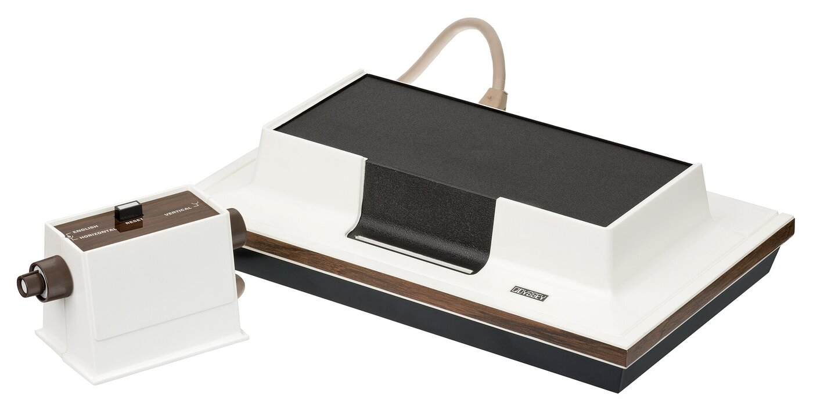
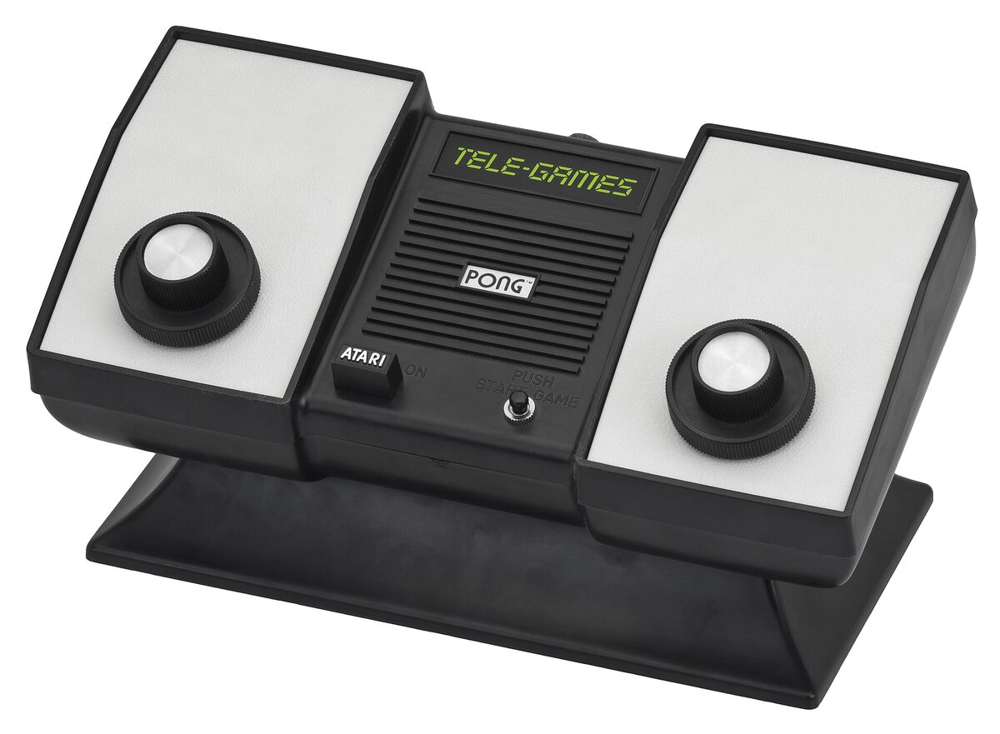
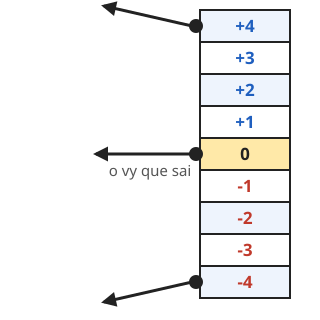

---slide--- title-slide

# Programação para crianças

## Aula 5 — Pong: o placar e as regras 🏆

---slide---

# Lembra da última aula? 🤔

- O que é uma **variável**?
- Bateu na parede **de cima**: o que acontece com o **vy**?
- Que teclas movem a **Raquete2**?

---slide---

# Hoje: o Projeto da aula 🏓

<div class="big" markdown="1">
1. Abra o **Projeto da aula** (um clique na **Sala**)
2. Joguem **em dupla**: **W e S** × **setas**
3. O placar é automático: cada lado tem o seu
</div>

---slide---

# O jogo que já temos 🟡

<div class="cols" markdown="1">
<div style="zoom: 0.5" markdown="1">

```blocks
defina bola_centro
vá para x: (0) y: (0)
espere (2) segs.
mude [vx v] para (5)
mude [vy v] para (número aleatório entre (2) e (4))
```

</div>
<div markdown="1">
- `bola_centro` = **meio + 2 s + saída**
- quem conta os gols é a **Bola**
- `vx` e `vy` são **só da Bola**
</div>
</div>

---slide---

# Magnavox Odyssey (1972) 🕹️

<div class="split" markdown="1">
<div markdown="1">
- **1972:** o primeiro console **de casa**, da Magnavox
- criado por **Ralph Baer** e a equipe dele
- a TV só mostrava **pontos e uma linha** — o cenário era um **plástico** na tela!
</div>
<div markdown="1">
{style="max-height: 100mm; display: block; margin: 0 auto"}
</div>
</div>

<p class="small muted">Foto: Evan-Amos, Wikimedia Commons (domínio público)</p>

---slide---

# O Home Pong (1975) 📺

<div class="split" markdown="1">
<div markdown="1">
- a **Atari** levou o Pong do fliperama para a **sala de casa**
- liga na **TV**, com dois **controles de girar**
- vendido pela **Sears** no **Natal de 1975**: perto de **150 mil** aparelhos!
</div>
<div markdown="1">
{style="max-height: 100mm; display: block; margin: 0 auto"}
</div>
</div>

<p class="small muted">Foto: Evan-Amos, Wikimedia Commons (CC BY-SA 3.0)</p>

---slide---

# Como você programaria? 🤔

<div class="big" markdown="1">
- O jogo **já conta os gols**…
- … mas como **acabar aos 7**?
- Quem deve **avisar** que alguém venceu?
- E como **parar tudo**?
</div>

---slide---

# O balão que some 🎈

<div class="big" markdown="1">
`pare todos` **apaga o balão**!
</div>

Por isso a fala vem com **`por (2) segundos`**:

<div style="zoom: 0.6" markdown="1">

```blocks
diga (junte [Vitória do jogador ] com (jogador)) por (2) segundos
pare [todos v]
```

</div>

O Scratch **espera** os 2 segundos e só **depois** para.

---slide---

# Passo 1: o `fim_jogo`

Na **Bola**, no código: o chapéu rosa `defina fim_jogo (jogador)` — troque:

<div style="zoom: 0.62" markdown="1">

```blocks
defina fim_jogo (jogador)
diga (junte [Vitória do jogador ] com (jogador)) por (2) segundos
pare [todos v]
```

</div>

As chamadas `fim_jogo (1)` e `fim_jogo (2)` **não mudam**.

---slide---

# Passo 1: e os testes do 7?

<div class="cols" markdown="1">
<div markdown="1">

```blocks
se <(gols_1) = (7)> então
  fim_jogo (1)
end
```

</div>
<div markdown="1">

```blocks
se <(gols_2) = (7)> então
  fim_jogo (2)
end
```

</div>
</div>

Eles ficam **onde estão**: depois do 7º gol a bola ainda espera 2 segundos no meio, então a fala aparece **logo depois do saque** — e o jogo **para**.

---slide---

# Como a bola acelera? 🤔

<div class="big" markdown="1">
- a bola sai com **vx = 5**; a cada rebatida, **mais rápida**
- na **Raquete1** o vx é **positivo** ➡️
- na **Raquete2** o vx é **negativo** ⬅️
- então: **+1** ou **-1**? 🤔
</div>

---slide---

# Passo 2: a bola acelera ⚡

Na **Bola**, dentro dos dois `se` das raquetes:

<div style="zoom: 0.5" markdown="1">

```blocks
se <<tocando em (Raquete1 v)?> e <(vx) < (0)>> então
  mude [vx v] para ((0) - (vx))
  adicione (1) a [vx v]
end
se <<tocando em (Raquete2 v)?> e <(vx) > (0)>> então
  mude [vx v] para ((0) - (vx))
  adicione (-1) a [vx v]
end
```

</div>

---slide---

# Jogue: quem chega aos 7? 🏆

<div class="big" markdown="1">
1. Joguem **em dupla**: **W e S** × **setas**
2. Marquem gols até chegar a **7**
3. A fala aparece e o jogo **para**
4. Bandeira verde: **0 × 0** de novo
</div>

**E se ninguém errar?** 🤔

---slide---

# Salvar e entregar 💾

<div class="big" markdown="1">
1. **Arquivo → Salvar como...** → nome **Pong**
2. **Entregar trabalho**: vamos continuar o Pong!
3. Dupla: **W e S** × **setas**
</div>

---slide---

# Desafios ⭐

<div class="big" markdown="1">
- ⭐ Vence quem fizer **3**
- ⭐ **Som** de vitória
- ⭐⭐ **Limite** de velocidade
- ⭐⭐⭐ Jogador 2 é o **computador**
</div>

---slide---

# O segredo da raquete de 1972 🕹️ {style="font-size: 44pt"}

<div class="split even" markdown="1">
<div markdown="1">
- no Pong de **1972** ela tinha **8 pedaços**
- cada pedaço devolvia num **ângulo diferente**
- **meio** = reto · **pontas** = inclinado
</div>
<div markdown="1">
{style="width: 100%; max-width: 84mm; display: block; margin: 0 auto"}
</div>
</div>

<p class="small muted">Desenho nosso: o original tinha 8 pedaços; o nosso tem 9 zonas, de -4 a +4.</p>

---slide---

# Hoje aprendemos 🎉

- **acaba aos 7**: `diga por 2 segundos` + `pare todos`
- o `pare` **apaga os balões** — daí os 2 segundos
- a bola **acelera**: `adicione 1` e `adicione -1`
- **+1** de um lado e **-1** do outro: é o **sinal** do vx

**Próxima:** continuar o Pong 🏓
