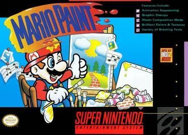
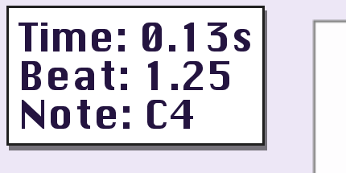
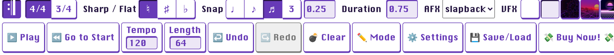
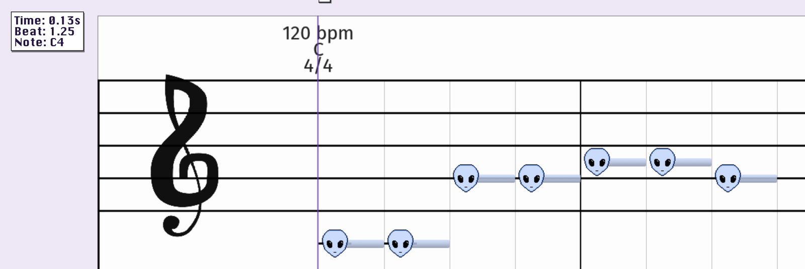
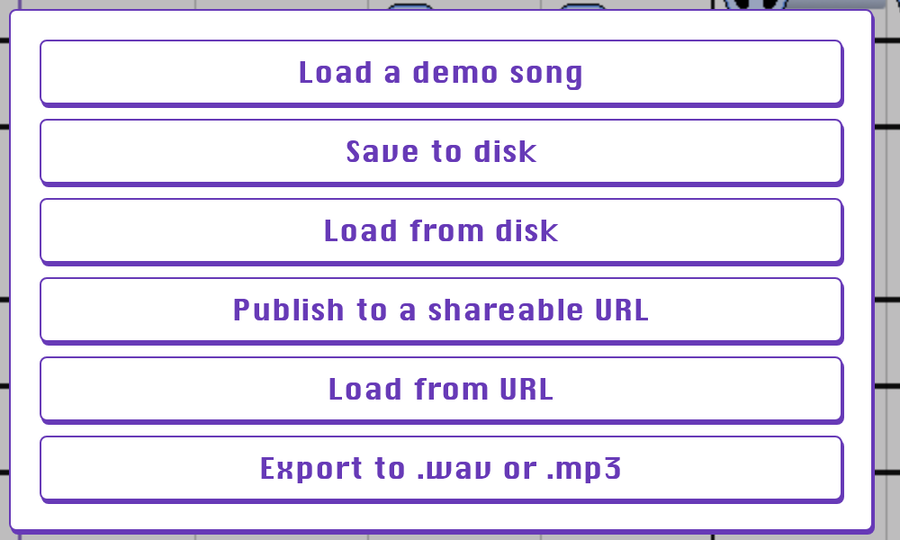
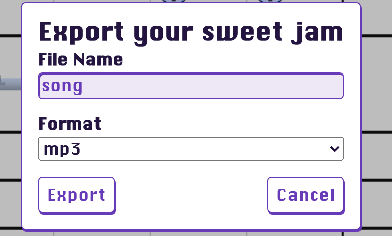

---slide--- title-slide

# Programação para crianças

## Aula 6 — Melodias: o computador toca música 🎵

---slide---

# Lembra da última aula? 🤔

- O que faz o bloco **`pare todos`**?
- Por que a bola acelerava com **+1** e **-1**?
- Quem ganha o **Pong**?

---slide---

# Hoje na Sala: Super Mario Bros. 🍄

<div style="font-size: 26pt" markdown="1">

1. Abra a **Sala** e escolha o seu **nome**
2. Jogue o **Super Mario Bros.** por **3 minutos**
3. Depois: **como o computador toca essa música?**

</div>

---slide---

# O som do NES (1985) 🎮 {style="font-size: 42pt"}

<div class="split" markdown="1">
<div style="font-size: 22pt" markdown="1">
- **Koji Kondo** escreveu a música do Super Mario Bros.
- o console tinha **um chip de som** com **5 canais**
- **duas ondas quadradas** (a melodia), **uma triangular** (o baixo), **um ruído** (a percussão) e **uma amostra**
- em **2023** a música entrou no **Registro Nacional de Gravações** dos EUA
</div>
<div markdown="1">
{style="max-height: 82mm; display: block; margin: 0 auto"}
</div>
</div>

<p class="small muted">Foto: Nico Hofmann, Wikimedia Commons (CC BY-SA 4.0)</p>

---slide---

# Mario Paint (1992) 🎨 {style="font-size: 42pt"}

<div class="split" markdown="1">
<div style="font-size: 22pt" markdown="1">
- no **Super Nintendo**, com o **mouse** do console
- o **compositor**: escolha um **ícone** e **carimbe** a nota na **pauta**
- só **notas de um tempo**, até **3 por batida**
- só as **notas brancas**: **dó maior**, sem sustenido
</div>
<div markdown="1">
{style="max-height: 76mm; display: block; margin: 0 auto"}
</div>
</div>

<p class="small muted">Capa do Mario Paint © Nintendo, uso ilustrativo (como na Wikipédia)</p>

---slide---

# As sete notas 🎹

<div class="big center" markdown="1">
**dó ré mi fá sol lá si**

**C D E F G A B**

Elas se **repetem**: depois do si vem o **dó** de novo!
</div>

---slide---

# O 4 de C4 🔢

<div style="font-size: 26pt" markdown="1">
- **C4** = o **dó do meio** do teclado
- o **4** é a **oitava** — o "andar" da nota
- **C5** é uma oitava **acima**: mais **agudo**
- **C3** é uma oitava **abaixo**: mais **grave**
</div>

<p class="big center" markdown="1">Quanto **maior** o número, mais **agudo** 🎵</p>

---slide---

# A batida 🥁

<div class="big center" markdown="1">
**1 2 3 4** · **1 2 3 4** · **1 2 3 4**

A **batida** é o relógio da música: **4/4**

**120 bpm** = 120 batidas por minuto

Cada batida dura **0,5 segundo**
</div>

---slide---

# Uma melodia 🎶

<div class="big center" markdown="1">
**Brilha, brilha, estrelinha**

**dó dó sol sol lá lá sol**

**fá fá mi mi ré ré dó**
</div>

<p class="center" markdown="1">Notas **uma depois da outra** = **melodia**</p>

---slide---

# Um acorde 🎼

<div style="font-size: 26pt" markdown="1">
Três notas **juntas**:

- **dó maior** = **dó mi sol** (C E G)
- **fá maior** = **fá lá dó** (F A C)
- **sol maior** = **sol si ré** (G B D)
</div>

<p class="center" markdown="1">Na **escala** de sol maior o **fá vira fá♯** — no Compositor, clique no **♯** antes da nota</p>

---slide---

# O Compositor 💻

<div style="font-size: 22pt" markdown="1">
- favorito **Compositor** no Firefox
- é em **inglês**: a gente traduz junto
- a **pauta** no meio; os **instrumentos** em cima
- **clique** para pôr a nota; **clique de novo** para tirar
- na primeira vez o Firefox pergunta dos **dispositivos MIDI**: responda **Não permitir**
</div>

<p class="center" style="font-size: 26pt" markdown="1">De vez em quando aparece a janela de **comprar**: clique num lugar **vazio** da pauta e ela fecha</p>

---slide---

# A pauta e o nome da nota 🔎

<div class="split even" markdown="1">
<div markdown="1">
{style="width: 100%; display: block; margin: 0 auto"}
</div>
<div style="font-size: 25pt" markdown="1">
- no canto: o **nome da nota** (aqui, **Note: C4**)
- o **dó 4** fica na **linha extra** abaixo da pauta
- **clique** põe; **clique de novo** tira
</div>
</div>

---slide---

# Os botões 🔘

{style="width: 100%; display: block; margin: 0 auto"}

<div class="cols" style="font-size: 22pt" markdown="1">
<div markdown="1">
- **Play** = tocar
- **Go to Start** = voltar
- **Tempo** = andamento (120)
- **Length** = duração
</div>
<div markdown="1">
- **Undo/Redo** = desfazer/refazer
- **Clear** = apagar tudo
- **Save/Load** = salvar e exportar
- **Buy Now!** = **não clique**
</div>
</div>

---slide---

# Passo 1: copiar a melodia {style="font-size: 44pt"}

<div class="cols" style="font-size: 22pt" markdown="1">
<div markdown="1">
**Onde fica cada nota:**

- **dó** (C4): linha extra **debaixo**
- **ré** (D4): espaço embaixo
- **mi** (E4): primeira linha
- **fá** (F4): primeiro espaço
</div>
<div markdown="1">

- **sol** (G4): segunda linha
- **lá** (A4): espaço acima dela
- **si** (B4): terceira linha

Confira o **Note:** no canto!
</div>
</div>

<p class="center" markdown="1">**dó dó sol sol lá lá sol** — uma nota por batida 🎵</p>

---slide---

# Passo 2: a sua música ✍️

<div style="font-size: 24pt" markdown="1">
1. Mais **quatro compassos** inventados
2. Só as notas **brancas** (dó a si)
3. **Length 32** = 8 compassos = **16 segundos**
4. ▶️ **Play** e ouça
</div>

{style="width: 58%; display: block; margin: 2mm auto 0"}

---slide---

# Exportar e salvar 💾

<div class="split even" markdown="1">
<div markdown="1">
{style="width: 100%; display: block; margin: 0 auto 2mm"}
</div>
<div markdown="1">
{style="width: 100%; display: block; margin: 0 auto 2mm"}
</div>
</div>

<p class="center" markdown="1">**Save to disk** = a partitura (`.midi`) · **Export** = o **MP3** — com o **seu nome** nos dois</p>

---slide---

# No Scratch: o som na Bailarina {style="font-size: 42pt"}

<div class="split" markdown="1">
<div style="font-size: 21pt" markdown="1">
1. Abra **`Aula6-Melodias`** (pasta **Aulas**)
2. Clique na **Bailarina**
3. Aba **Sons** → **Carregar som**
4. Escolha o MP3 em **Downloads**
</div>
<div markdown="1">

```blocks
quando @greenFlag for clicado
toque o som (brilha v) até o fim
```
</div>
</div>

---slide---

# No Scratch: dançar na batida {style="font-size: 46pt"}

<div style="zoom: 0.78" markdown="1">

```blocks
quando @greenFlag for clicado
sempre
  próxima fantasia
  espere (0.5) seg
end
```

</div>

<p class="center" style="font-size: 28pt" markdown="1">**0,5 segundo** = **uma batida** a 120 bpm 🥁</p>

---slide---

# Salvar e entregar 💾

<div style="font-size: 26pt" markdown="1">

1. **Arquivo → Salvar como...** → **Melodias**
2. **Entregar trabalho** — **três** arquivos:
    - o **`.sb3`**
    - o **MP3**
    - o **`.midi`**

</div>

---slide---

# Desafios ⭐

<div style="font-size: 24pt" markdown="1">
- ⭐ A **escala** inteira (dó a dó)
- ⭐ Mais **devagar**, mais **rápido**
- ⭐ A bailarina **duas vezes** por batida
- ⭐⭐ Os acordes de **fá** e de **sol**
- ⭐⭐ **Teclado do Scratch**
- ⭐⭐ Mais **compassos**, duas notas por vez
- ⭐⭐⭐ **Duas vozes**: melodia e baixo
</div>

---slide---

# Hoje aprendemos 🎉

<div style="font-size: 23pt" markdown="1">
- as **sete notas**: **dó = C** … **si = B**
- o número é a **oitava**: **C4** é o dó do meio
- a **batida** em 4/4; a 120 bpm, **0,5 s** por batida
- no Compositor: **clique** põe, **clique** tira; **Export** = MP3, **Save to disk** = `.midi`
- a bailarina dança **no ritmo** com `espere (0.5) seg`
</div>

<p class="big center" markdown="1">**Próxima aula:** as **batidas** — a bateria da sua música! 🥁</p>
