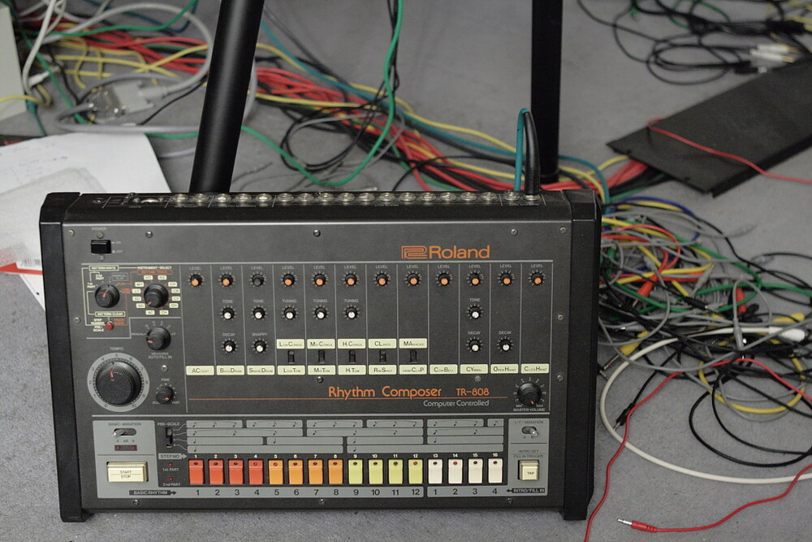
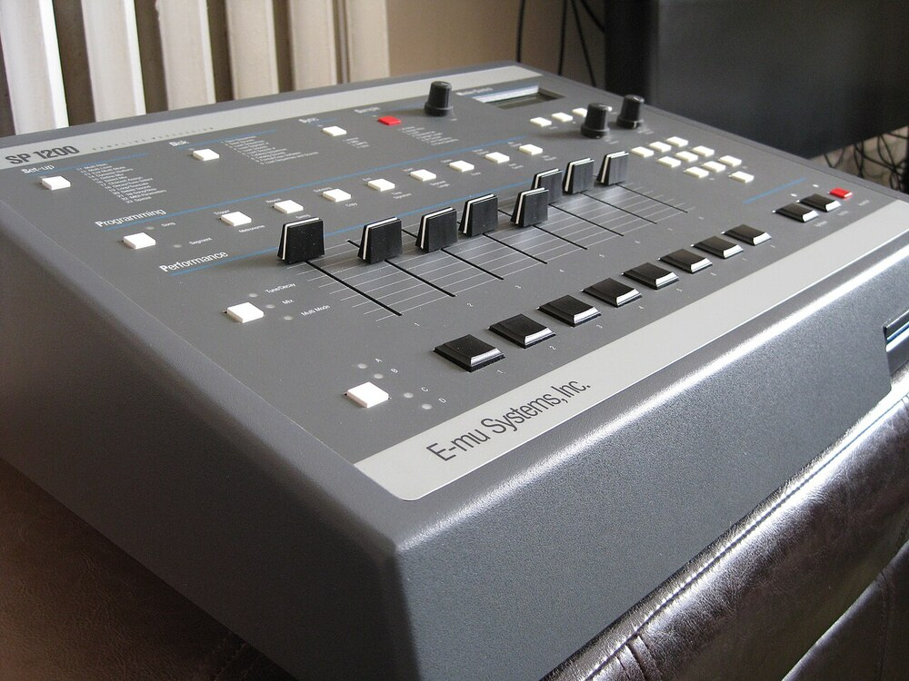
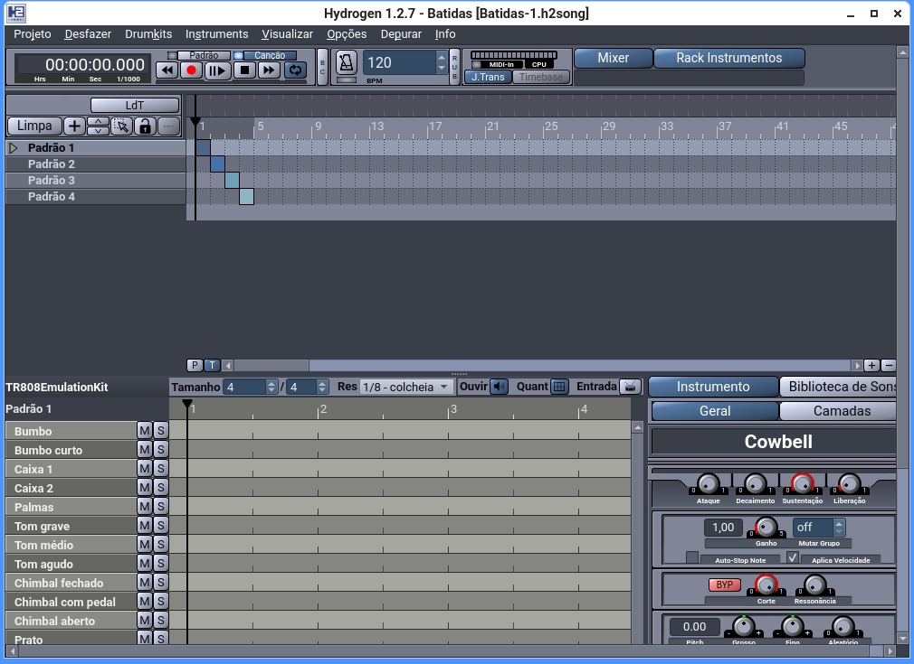
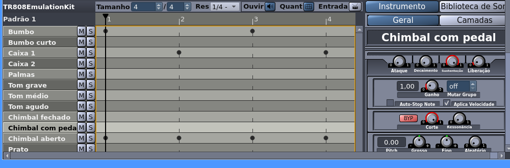
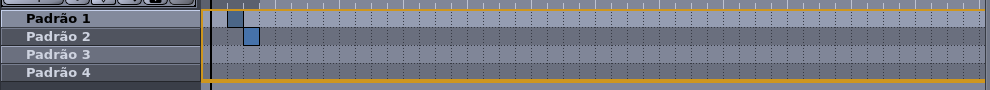
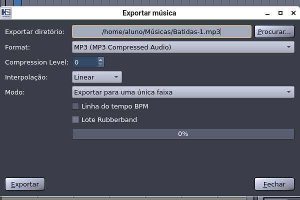

---slide--- title-slide

# Programação para crianças

## Aula 7 — Batidas: a bateria da sua música 🥁

---slide---

# Lembra da última aula? 🤔

- Quantas notas tem a escala? E depois do **si**?
- O que é o **C4**?
- Quanto dura uma batida a **120 bpm**?

---slide---

# Hoje: o **seu** projeto 🎵

<div style="font-size: 26pt" markdown="1">

1. **Sala → Meus arquivos** → o seu projeto da **última aula** (o primeiro da lista)
2. **Bandeira verde**: a música toca e a bailarina dança
3. Hoje ela ganha uma **bateria** — e as duas tocam **juntas**!

</div>

<p class="center" markdown="1">Quem faltou na Aula 6 abre o **`Aula7-Batidas`** (pasta **Aulas**)</p>

---slide---

# Na Sala: a telha Batidas 🎧

<div style="font-size: 26pt" markdown="1">

- a telha **Batidas** abre uma **grade de amostras**
- clique nas células e ouça **na hora**
- há **mais de 150** sons para trocar
- hoje: só **escutar** e descobrir os instrumentos

</div>

---slide---

# A caixa de ritmos TR-808 (1980) 🥁 {style="font-size: 40pt"}

<div class="split" markdown="1">
<div style="font-size: 22pt" markdown="1">
- a **Roland TR-808** foi uma das primeiras em que se **programa** a batida
- os sons eram **feitos na hora**, com circuitos (analógicos)
- **não vendeu bem**: uns **12 mil** aparelhos
- o **bumbo** dela virou a marca do **hip-hop** e da música eletrônica
</div>
<div markdown="1">
{style="max-height: 78mm; display: block; margin: 0 auto"}
</div>
</div>

<p class="small muted">Foto: fr4dd, Wikimedia Commons (CC BY 2.0)</p>

---slide---

# Amostras (samples) 🎛️ {style="font-size: 44pt"}

<div class="split" markdown="1">
<div style="font-size: 22pt" markdown="1">
- uma **amostra** é um **pedacinho de som gravado** que a gente reutiliza
- a palavra nasceu no fim dos anos **1970**, com o **Fairlight**
- nos anos **1980**, o **SP-1200** e o **MPC** baratearam a ideia
- o hip-hop nasceu **recortando** trechos de discos antigos
</div>
<div markdown="1">
{style="max-height: 74mm; display: block; margin: 0 auto"}
</div>
</div>

<p class="small muted">Foto: 2xUeL, Wikimedia Commons (domínio público)</p>

---slide---

# A bateria: quem toca em cada tempo 🥁

| | **1** | **2** | **3** | **4** |
|---|---|---|---|---|
| **Bumbo** | ● | | ● | |
| **Caixa** | | ● | | ● |
| **Chimbal** | ● | ● | ● | ● |

<div style="font-size: 24pt" markdown="1">

**tum** nos 1 e 3 · **tá** nos 2 e 4 · **tch** em todos

</div>

---slide---

# Padrão × Canção 🎼

<div class="split even" markdown="1">
<div style="font-size: 25pt" markdown="1">
**Padrão** = **um compasso** de bateria

**Canção** = **muitos compassos em ordem** (uma fila de padrões)
</div>
<div style="font-size: 25pt" markdown="1">
A nossa: **8 compassos** = **16 segundos**, os mesmos da melodia da Aula 6

(o template já vem com 4 compassos na canção — a gente apaga e monta a nossa)
</div>
</div>

---slide---

# O Hydrogen: a tela 👀 {style="font-size: 40pt"}

<div class="split" markdown="1">
<div markdown="1">
{style="width: 100%; display: block; margin: 0 auto"}
</div>
<div style="font-size: 20pt" markdown="1">
- em cima: menus e o **andamento** (120)
- no meio: os **padrões** e a **grade**
- embaixo: as **linhas dos instrumentos**
- os botões **Padrão** e **Canção** dizem o **modo**
</div>
</div>

---slide---

# Passo 1: o bumbo {style="font-size: 46pt"}

{style="width: 100%; display: block; margin: 0 auto"}

<p class="center" style="font-size: 26pt" markdown="1">No **Padrão 1**, clique nas colunas **1** e **3** da linha **Bumbo** — **clique de novo** para tirar — e aperte **▶**.</p>

---slide---

# Passo 2: a caixa

**Ainda no Padrão 1**, clique a **Caixa 1** nas colunas **2** e **4**.

<p class="center" markdown="1">"tum **tá** tum **tá**" 🥁</p>

---slide---

# Passo 3: o chimbal

No **mesmo Padrão 1**, ponha o **Chimbal fechado** em **todas** as colunas.

<p class="center" markdown="1">"tch tch tch tch" — agora o **Padrão 1 é uma batida inteira** ⏱️</p>

---slide---

# Passos 4 e 5: a variação e a canção {style="font-size: 42pt"}

<div style="font-size: 21pt" markdown="1">
1. **Padrão 2**: a mesma batida + **bumbo em 2 e 4** = a variação
2. **Padrão 4**: **caixa em todos** os tempos = a virada
3. Em **Canção**: **uma linha por padrão**, **uma coluna por compasso**
4. **Clique** na linha do padrão que você quer (clique de novo **tira**)
5. Monte **8**: **1 · 1 · 2 · 1 · 1 · 1 · 2 · 4**
6. **▶** e ouça a música inteira
</div>

{style="width: 96%; display: block; margin: 1mm auto"}

<p class="center" style="font-size: 21pt" markdown="1">Botão direito → **Selecionar tudo** → **Remover** apaga a fila do template</p>

---slide---

# Exportar e salvar 💾

<div class="split" markdown="1">
<div markdown="1">
{style="width: 100%; display: block; margin: 0 auto"}
</div>
<div style="font-size: 22pt" markdown="1">
**Projeto → Exportar Canção**

**Formato**: já vem **MP3** → **Exportar**

(sai em **Músicas**)

Depois: **Projeto → Salvar Como...** → pasta **Músicas** → `.h2song`
</div>
</div>

---slide---

# No Scratch: a batida na Bateria {style="font-size: 42pt"}

<div style="font-size: 22pt" markdown="1">
1. **Escolher um Ator** → **Drum Kit** → renomeie para **Bateria**
2. Clique na **Bateria** → aba **Sons** → **Carregar som**
3. Escolha o MP3 da batida
4. Na Bateria:
</div>

<div style="zoom: 0.62" markdown="1">

```blocks
quando @greenFlag for clicado
toque o som (Batidas-1 v) até o fim
```

</div>

---slide---

# As duas juntas 🩰🥁

<div style="font-size: 24pt" markdown="1">
- a **Bailarina** já toca a melodia e dança
- a **Bateria** toca a batida
- as duas começam na **bandeira verde** — no **mesmo instante**
- mesmo **andamento** (120), mesmo **compasso** (4/4), mesmo **começo**
</div>

<p class="center" markdown="1">Se a melodia é **8 compassos**, a batida também tem que ser **8** ✅</p>

---slide---

# Salvar e entregar 💾

<div style="font-size: 26pt" markdown="1">

1. **Arquivo → Salvar como...** → **Batidas**
2. **Entregar trabalho** — **três** arquivos:
    - o **`.sb3`**
    - o **MP3** da batida
    - o **`.h2song`**

</div>

---slide---

# Desafios ⭐

<div style="font-size: 24pt" markdown="1">
- ⭐ **Trocar o kit** (GMRockKit)
- ⭐ Mais **devagar** (90 BPM)
- ⭐ **Bumbo e caixa trocados**
- ⭐⭐ A **virada no meio** também
- ⭐⭐ **Chimbal em colcheias**
- ⭐⭐ A canção de **16 compassos**
- ⭐⭐ A **Bateria dança** também
- ⭐⭐⭐ Um padrão de **dois compassos**
</div>

---slide---

# Hoje aprendemos 🎉

<div style="font-size: 23pt" markdown="1">
- a **grade da bateria**: bumbo 1 e 3, caixa 2 e 4, chimbal em todos
- **padrão** = um compasso; **canção** = padrões em ordem
- no Hydrogen: **Projeto → Exportar Canção** (MP3) e **Salvar Como...** (`.h2song`)
- as duas músicas **casam** porque têm o mesmo andamento, compasso e começo
</div>

<p class="big center" markdown="1">**Próxima aula:** o **projeto livre** — o seu jogo, do seu jeito! 🚀</p>
